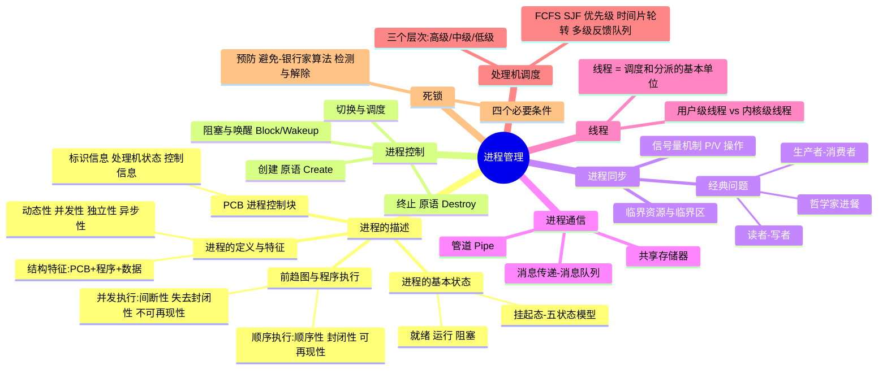
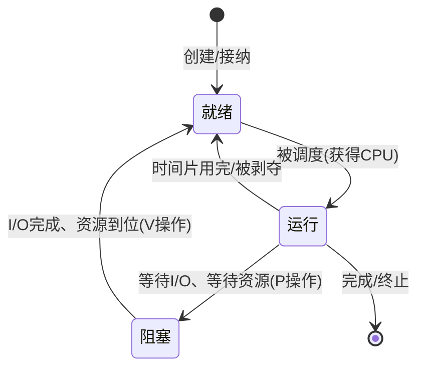

# 目标01 学习笔记：OS Kernel 进程管理

> 对应教材：汤子瀛《计算机操作系统》第二章 进程的描述与控制、第三章 处理机调度与死锁
> 日期：2026/09 ｜ 数据科学2401 ｜ 杨显坤 202423030104

---

## 一、本章思维导图



---

## 二、进程的三状态转换（重点图）



**易错点：**
1. 阻塞 → 运行 ❌ 不存在！阻塞必须先回到就绪队列排队；
2. 就绪 → 阻塞 ❌ 不存在！就绪态缺的只是 CPU，不是等待事件；
3. 运行 → 阻塞 是**主动行为**（程序自己请求 I/O），阻塞 → 就绪 是**被动行为**（被别人唤醒）。

---

## 三、进程 vs 程序（常考对比）

| 对比项 | 程序 | 进程 |
|---|---|---|
| 本质 | 静态的指令集合 | 动态的执行过程 |
| 生命周期 | 永久保存 | 有创建有消亡 |
| 组成 | 代码+数据 | PCB + 程序 + 数据 |
| 对应关系 | 一个程序可对应多个进程 | 一对一 |
| 并发性 | 无（未执行） | 可并发执行 |

---

## 四、信号量与 P/V 操作（核心代码）

信号量 `S`：一个整型变量，只能由 **P(wait)** 和 **V(signal)** 两个原语操作。

```c
// P 操作：申请资源
P(S) {
    S = S - 1;
    if (S < 0) block();   // 资源不够，进程进入阻塞队列
}

// V 操作：释放资源
V(S) {
    S = S + 1;
    if (S <= 0) wakeup(); // 唤醒一个等待进程
}
```

### 经典问题：生产者-消费者（必须会默写）

```c
semaphore mutex = 1;    // 互斥访问缓冲池
semaphore empty = n;    // 空缓冲区数量
semaphore full  = 0;    // 满缓冲区数量

Producer:                    Consumer:
while(true) {                while(true) {
    生产一个产品;                 P(full);
    P(empty);   // 先申请空缓冲    P(mutex);
    P(mutex);   // 再加锁         取一个产品;
    产品放入缓冲池;                V(mutex);
    V(mutex);                    V(empty);
    V(full);    // 最后通知消费者   消费产品;
}                            }
```

**易错点：**
1. `P(empty)` 必须在 `P(mutex)` **之前**！顺序反了会死锁（生产者拿着锁等空缓冲，消费者等锁）；
2. 两个 V 操作顺序可以互换，不影响正确性；
3. `empty` 初值为缓冲区大小 n，`full` 初值为 0，别写反。

---

## 五、处理机调度


### 常见调度算法对比

| 算法 | 规则 | 优点 | 缺点 | 是否可抢占 |
|---|---|---|---|---|
| FCFS 先来先服务 | 按到达顺序 | 公平、简单 | 对短作业不利 | 否 |
| SJF 短作业优先 | 运行时间最短优先 | 平均等待时间最短 | 长作业饥饿 | 否 |
| 优先级调度 | 优先级高先跑 | 灵活 | 低优先级饥饿 | 可配 |
| RR 时间片轮转 | 就绪队列轮流跑一个时间片 | 响应快，适合分时系统 | 时间片选择影响大 | 是 |
| 多级反馈队列 | 多个队列+降级 | 综合最优 | 实现复杂 | 是 |

**计算题套路：** 周转时间 = 完成时间 − 到达时间；带权周转时间 = 周转时间 ÷ 运行时间。

---

## 六、死锁

### 四个必要条件（缺一不可，要会背）
1. **互斥**：资源一次只能被一个进程使用
2. **请求和保持**：占着资源还要申请新资源
3. **不可剥夺**：资源不能被强行抢走
4. **循环等待**：形成资源等待环

### 处理策略
- **预防**：破坏四个条件之一（如一次性申请全部资源破坏"请求保持"）
- **避免**：银行家算法（动态判断系统是否处于安全状态）
- **检测与解除**：资源分配图化简，发现死锁后剥夺/撤销进程

### 银行家算法核心思想（伪代码）

```c
// 每次进程 Request 资源时：
1. 若 Request <= Need      才继续，否则报错
2. 若 Request <= Available 才继续，否则等待
3. 试探性分配：Available -= Request;  Allocation += Request;  Need -= Request;
4. 执行安全性检测算法：
   找一个 Need <= Work 的进程，假设它完成后归还资源
   Work += Allocation[i]，标记完成，重复
5. 若所有进程都能完成 → 安全，正式分配；否则 → 回滚，让进程等待
```

**易错点：** "不安全状态" ≠ 死锁，只是**可能**发生死锁；安全状态一定无死锁。

---

## 七、线程

- 线程是**调度和分派的基本单位**，进程是**资源分配的基本单位**（这句话常考填空）。
- 用户级线程（ULT）：内核看不见，切换快，但一个线程阻塞整个进程阻塞；
- 内核级线程（KLT）：内核调度，能并发到多核，但切换需要陷入内核。

---

## 八、我的疑问与补充

- [ ] 多级反馈队列中时间片通常如何递增？（一般是 2 倍递增）
- [ ] 管道通信为什么要求读写进程同步？
