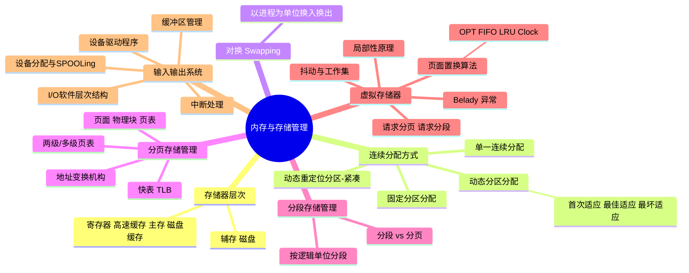
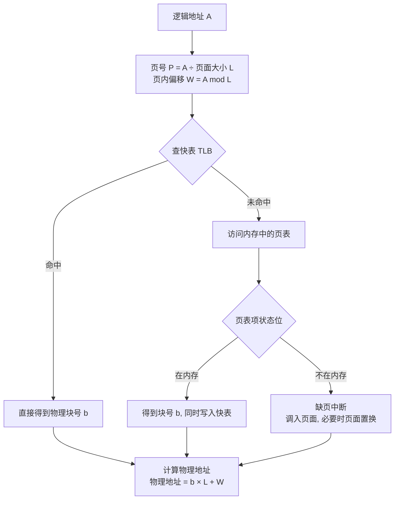
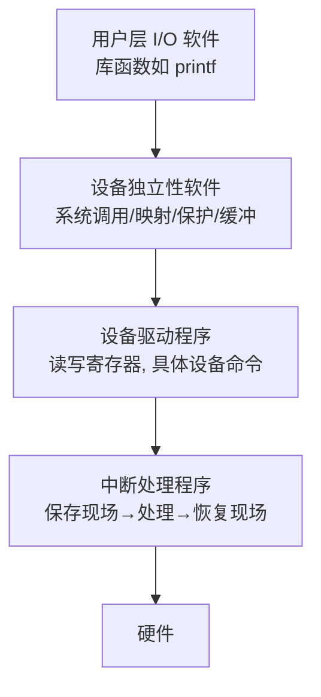

# 目标02 学习笔记：OS Kernel 内存与存储管理

> 对应教材：汤子瀛《计算机操作系统》第四章 存储器管理、第五章 虚拟存储器、第六章 输入输出系统
> 日期：2026/10 ｜ 数据科学2401 ｜ 杨显坤 202423030104

---

## 一、本章思维导图



---

## 二、分页系统的地址变换（重点流程图）



**易错点：**
1. 一次**有效访问**在无快表时需要 **2 次访存**（查页表 1 次 + 取数据 1 次）；有快表且命中只需 1 次；
2. 缺页中断属于**内中断**，且在指令执行期间产生并处理（区别于一般外中断）；
3. 页面大小和物理块大小**相等**。

### 地址变换计算例题套路

> 页面大小 1KB，逻辑地址 2500 → P = 2500 ÷ 1024 = **2**，W = 2500 mod 1024 = **452**
> 若页表知 2 号页对应块号 8 → 物理地址 = 8 × 1024 + 452 = **8644**

---

## 三、页面置换算法对比

| 算法 | 思想 | 优点 | 缺点 |
|---|---|---|---|
| OPT 最佳 | 淘汰以后最长时间不用的页 | 缺页率最低（理论） | 无法实现（要预知未来），作评价基准 |
| FIFO 先进先出 | 淘汰最先进入的页 | 实现简单 | 有 **Belady 异常**（页框越多缺页反而可能越多） |
| LRU 最近最久未使用 | 淘汰最长时间没被访问的页 | 性能接近 OPT | 硬件开销大（要记访问时间） |
| Clock/NRU | 循环扫描，访问位为 0 则淘汰 | 开销小 | 只是 LRU 的近似 |

### LRU 核心代码（理解思想用）

```python
def lru_missing_count(pages, capacity):
    mem, misses = [], 0
    for p in pages:
        if p in mem:
            mem.remove(p)      # 刚访问过，移到"最新"位置
        else:
            misses += 1        # 缺页
            if len(mem) == capacity:
                mem.pop(0)     # 淘汰最久未使用的
        mem.append(p)
    return misses

# 验证 Belady 异常用 FIFO 而不是 LRU
def fifo_missing_count(pages, capacity):
    mem, misses = [], 0
    for p in pages:
        if p not in mem:
            misses += 1
            if len(mem) == capacity:
                mem.pop(0)
            mem.append(p)
    return misses
```

**易错点：**
1. LRU 是"**最近**没被访问"，不是"访问次数最少"（那是 LFU）；
2. 增加分配页框数，FIFO 的缺页次数**可能不降反升**——Belady 异常；LRU 和 OPT 无此异常；
3. 置换前先查页表确认真的不在内存，别上来就置换。

---

## 四、分段 vs 分页（必考对比）

| 对比项 | 分页 | 分段 |
|---|---|---|
| 单位依据 | 物理划分，固定大小 | 逻辑划分（代码段/数据段），不定长 |
| 目的 | 提高内存利用率 | 满足用户模块化、共享与保护需求 |
| 地址空间 | 一维（一个地址数字） | 二维（段号 + 段内偏移） |
| 碎片 | 有内部碎片，无外部碎片 | 有外部碎片，无内部碎片 |
| 共享 | 难 | 容易（对可重入代码共享一段） |

---

## 五、虚拟存储器三大特征 + 局部性原理

1. **多次性**：作业分多次调入内存
2. **对换性**：可换入换出
3. **虚拟性**：逻辑容量 = min(内外存之和, 地址空间)

理论基础：**局部性原理**（时间局部性 + 空间局部性）。

**抖动（颠簸）**：页面频繁换入换出，CPU 利用率骤降 → 用**工作集**模型控制：给进程分配 ≥ 工作集的页框数。

---

## 六、I/O 系统：软件层次（从上到下背）



**每层任务一句话：** 用户层管"好用"，设备独立性软件管"统一接口+缓冲+分配"，驱动管"懂设备"，中断管"善后"。

### 中断处理流程


### 缓冲区为什么能提速？（易考简答）

- 缓和 CPU 与 I/O 设备速度不匹配的矛盾；
- 减少对 CPU 的中断频率，放宽中断响应时间限制；
- 提高 CPU 与 I/O 设备的**并行性**。
- 单缓冲：处理一块时间 ≈ max(C, T) + M；双缓冲：≈ max(C + M, T)。（C=处理时间，T=输入时间，M=传送时间）

---

## 七、我的疑问与补充

- [ ] Clock 算法里访问位和修改位组成 4 种情况，优先淘汰哪类？（(0,0)→(0,1)）
- [ ] SPOOLing 如何把独占设备改造成共享设备？（用磁盘上的输入/输出井模拟）
