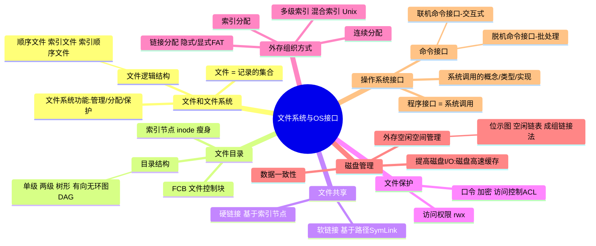
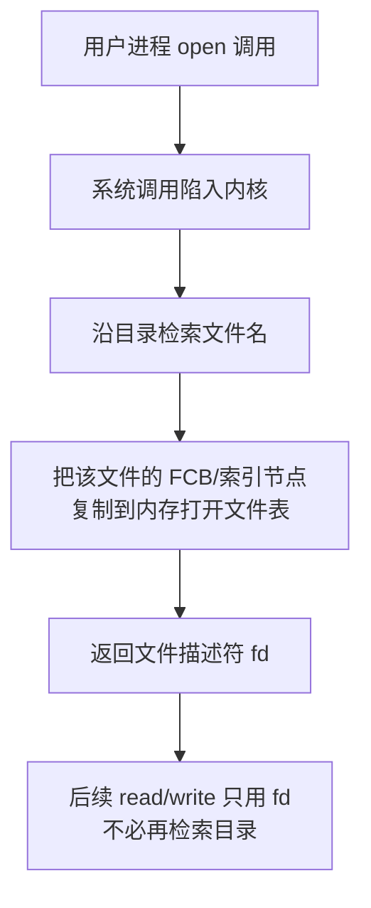
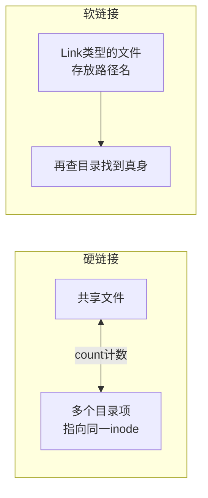
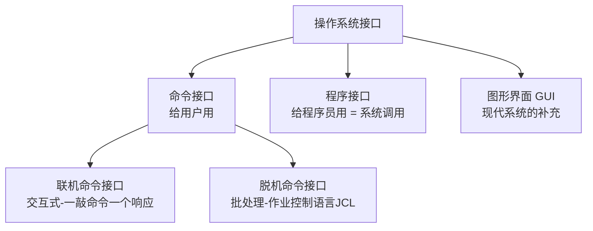

# 目标03 学习笔记：OS Kernel 文件系统管理与操作系统接口

> 对应教材：汤子瀛《计算机操作系统》第七章 文件管理、第九章 操作系统接口
> 日期：2026/11 ｜ 数据科学2401 ｜ 杨显坤 202423030104

---

## 一、本章思维导图



---

## 二、外存组织方式对比（核心考点）

| 方式 | 思想 | 优点 | 缺点 |
|---|---|---|---|
| 连续分配 | 文件占连续的磁盘块 | 支持随机访问，速度快 | 有外部碎片，文件难扩展 |
| 隐式链接 | 每块含指向下一块的指针 | 无外部碎片，易扩展 | 只能顺序访问，指针占空间 |
| 显式链接 **FAT** | 指针集中存到一张 FAT 表 | 查表在内存，支持随机访问 | FAT 表占内存，掉电易失 |
| 索引分配 | 每个文件一张索引表 | 支持随机+直接访问 | 小文件也需一块存索引表 |
| 混合索引（UNIX） | 直接地址 + 一/二/三级间接地址 | 兼顾大小文件 | 结构复杂 |

**计算题套路（UNIX 混合索引）：**
> 设块大小 4KB，每块可存 1K 个地址（4B/个）：
> 直接地址 10 块 → 最大 40KB
> + 一级间接 +1K 块，+ 二级间接 +1M 块，+ 三级间接 +1G 块
> 最大文件 = (10 + 1K + 1M + 1G) × 4KB

### 打开文件的过程（流程图）



**易错点：** "打开文件"是把 **FCB（索引结点）** 调入内存，而不是把文件内容读进内存；`read` 时才按索引表去磁盘读数据块。

---

## 三、文件共享：硬链接 vs 软链接（必考）



| 对比项 | 硬链接 | 软链接（符号链接） |
|---|---|---|
| 本质 | 多个目录项指向同一 inode | 一个新文件，内容是路径 |
| 文件删除 | 计数 -1，=0 才真正删除 | 原文件删除后链接失效（悬空） |
 | 能否跨文件系统 | 不能 | 能 |
| 能否给目录建链 | 不能（防环） | 能 |

---

## 四、外存空闲空间管理

| 方法 | 思想 | 代表 |
|---|---|---|
| 空闲表 | 记录 (起始块号, 空闲块数) | 连续分配场合 |
| 空闲链表 | 空闲盘块/盘区串成链 | 简单但效率低 |
| **位示图** | 每个盘块对应一个 0/1 位 | 最常用，考试爱考 |

**位示图计算题套路：**
> 字长 32 位，盘块号、字号从 0 开始：
> 盘块 b 对应 字号 = b ÷ 32（取整），位号 = b mod 32
> 反过来：盘块号 = 字号 × 32 + 位号

UNIX 采用 **成组链接法**：空闲盘块号分组管理，第一组的信息放在超级块的空闲盘块号栈中。

---

## 五、操作系统接口



### 系统调用（程序接口的唯一入口）

系统调用的执行过程：


**易错点：**
1. 系统调用运行在**核心态**，普通库函数（如 `printf` 内部的格式化）运行在**用户态**——`printf` 是"库函数 + 最终触发 write 系统调用"的组合；
2. 陷入（trap）≠ 中断：trap 是**主动**的，由程序内部产生；中断是被动的；
3. 用户态 → 核心态**唯一**的合法途径就是中断/异常（包括系统调用）。

### 一个系统调用的直观例子（Linux C）

```c
#include <unistd.h>
#include <fcntl.h>

int main() {
    // open/read/write/close 都是系统调用
    int fd = open("test.txt", O_RDONLY);   // ① 打开文件, 得到描述符
    char buf[128];
    int n = read(fd, buf, sizeof(buf));    // ② 从文件读数据(核心态)
    write(STDOUT_FILENO, buf, n);          // ③ 写到标准输出
    close(fd);                             // ④ 关闭文件, 释放打开文件表项
    return 0;
}
```

---

## 六、我的疑问与补充

- [ ] 为什么树形目录检索要"从根目录逐级"或"从当前目录"？（相对路径 vs 绝对路径）
- [ ] 成组链接法中分配和回收空闲块的具体操作顺序？
